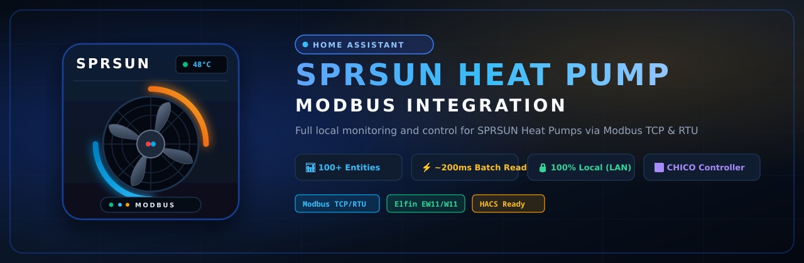

<div align="center">
  
</div>

# SPRSUN Heat Pump Modbus Integration for Home Assistant

[](https://github.com/hacs/integration)
[](https://github.com/stasek44/sprsun-modbus/releases)
[](LICENSE)

Home Assistant integration for SPRSUN heat pumps via Modbus TCP (e.g. using an Elfin-EW11 / W11 RS485-to-WiFi/Ethernet gateway).

> ⚠️ **Controller Compatibility:** Tested on model **CGK-025V3L-B** with the **CHICO** controller. This integration exclusively supports SPRSUN heat pumps equipped with **CHICO** controllers.

---

## Features

- **Climate Platform**: Standard HVAC controls for target temperature, modes (Heating, Cooling, DHW), and presets.
- **100+ Diagnostic & Control Entities**:
  - **Sensors**: Flow & return temperatures, DHW cylinder, outdoor ambient, refrigerant pressures, COP, thermal capacity, voltage, current, and compressor frequency.
  - **Binary Sensors**: Operational flags, compressor/fan/pump relays, 3-way/4-way valves, defrost status, and error indicators.
  - **Numbers & Selects**: Heating/cooling/DHW setpoints, hysteresis differentials, weather compensation curve points, fan modes, and circulation pump modes.
  - **Switches & Buttons**: Master power switch, antilegionella switch, two/three-function mode, and single-click alarm reset.
- **Fast Batch Reading**: Reads all 50 monitoring registers in a single Modbus TCP request (~200ms) with persistent connection handling.
- **Safe Writes**: Turnaround delay between writes to allow the heat pump MCU EEPROM commit time, protecting against bus collisions.

---

## Hardware Setup

### Wiring (Heat Pump to Gateway)
Connect the heat pump RS485 terminals to your Modbus bridge (e.g., Elfin EW11):
- **A/+** (Heat pump) → **A** (Gateway)
- **B/-** (Heat pump) → **B** (Gateway)
- **GND** (Heat pump) → **GND** (Gateway, strongly recommended for signal integrity)

### Recommended Gateway Settings (Elfin EW11 / W11)
- **Communication Settings (Network / Socket):**
  - **Protocol:** `TCP Server`
  - **Port:** `502`
  - **Timeout:** `5s`–`10s` (purges dead socket slots quickly; avoid 60s+ which holds dead sockets)
  - **Max Accept:** `1` (CRITICAL: prevents socket contention and RS485 frame interleaving)
  - **Buffer Size:** `512`
  - **Keep Alive:** `60s`
- **Serial Port Settings (RS485):**
  - **Baud Rate:** `19200`
  - **Data Bits:** `8`
  - **Stop Bits:** `2` (or `1` depending on unit)
  - **Parity:** `None`
  - **Flow Control:** `Half Duplex`
  - **Gap Time:** `20ms`–`50ms`
  - **CLI Settings:** `Disable` (CRITICAL: prevents raw binary bytes from triggering CLI mode)
  - **Protocol:** `Modbus` (enables Modbus RTU <-> Modbus TCP translation)

---

## Installation

### Via HACS (Recommended)
1. Open **HACS** → **Integrations** → Three dots menu (top right) → **Custom repositories**.
2. Add URL: `https://github.com/stasek44/sprsun-modbus` with category **Integration**.
3. Search for **SPRSUN Modbus**, click **Download**, and restart Home Assistant.

### Manual Installation
Copy the directory `custom_components/sprsun_modbus` into your Home Assistant `<config>/custom_components/` directory and restart Home Assistant.

---

## Configuration

1. In Home Assistant, go to **Settings** → **Devices & Services** → **Add Integration**.
2. Search for **SPRSUN Heat Pump (Modbus)**.
3. Configure the connection parameters:
   - **Host:** IP address of your Modbus bridge (e.g. `192.168.1.200`)
   - **Port:** `502`
   - **Device Address:** Modbus slave address (typically `1`)
   - **Scan Interval:** `10`–`30` seconds
   - **Temperature Step:** `0.5°C` (default) or `1.0°C` (set to `1.0°C` if your heat pump model or firmware enforces 1°C steps and rejects half-degree setpoints)
4. Save. Entities will be discovered and created automatically.

Options (including **Scan Interval** and **Temperature Step**) can be updated at any time under **Configure** on the integration card.

---

## Documentation

- 📖 **[CHICO Parameters & Settings Guide](docs/CHICO_PARAMETERS_GUIDE.md)**: Detailed explanations of all parameters (P, E, G series), curves, safety limits, and practical tips.
- 📚 **[CHICO Modbus Protocol Reference](docs/CHICO_MODBUS_REFERENCE.md)**: Complete register map, data types, scales, and bitfield definitions.
- ❄️ **[Climate Entity Options](docs/CLIMATE_ENTITY_OPTIONS.md)**: Architecture notes regarding HVAC climate entity mappings.

---

## Development & Testing

Run unit tests locally (no external hardware or Home Assistant instance required):

```bash
# Run test suite
python3 -m unittest discover tests

# Or run with pytest and coverage
pytest tests/ -v --cov=custom_components/sprsun_modbus
```

Automated CI workflows (`.github/workflows/`) run test matrices and code validation on every pull request.

---

## Contributing & Agent Guidelines

See **[AGENTS.md](AGENTS.md)** for development guidelines and required steps after every change:
1. Update tests.
2. Run tests to ensure 100% pass rate.
3. Keep documentation updated.
4. Maintain English as the primary language (Polish only in `translations/pl.json`).

---

## License

MIT License — see [LICENSE](LICENSE).
